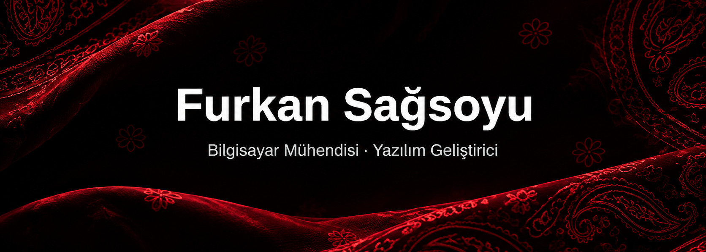

<!-- ═══════════════ ÜST BANNER ═══════════════ -->
<p align="center">
  
</p>

<!-- ═══════════════ YAZAN SATIRLAR ═══════════════ -->
<p align="center">
  <a href="https://furkansagsoyu.github.io">
    
  </a>
</p>

<!-- ═══════════════ BAĞLANTILAR ═══════════════ -->
<p align="center">
  <a href="https://furkansagsoyu.github.io"></a>
  <a href="https://www.linkedin.com/in/furkansagsoyu/"></a>
  <a href="mailto:furkansagsoyu@hotmail.com"></a>
  <a href="https://furkansagsoyu.github.io/files/furkan_sagsoyu_cv.pdf"></a>
</p>

<p align="center">
  
  
  
</p>

---

## 👨‍💻 Hakkımda

```python
class Furkan:
    def __init__(self):
        self.okul      = "Tokat Gaziosmanpaşa Üniversitesi — Bilgisayar Mühendisliği"
        self.erasmus   = "Politechnika Bydgoska, Polonya (2025–2026)"
        self.konum     = "Tokat, Türkiye"
        self.diller    = ["Java", "C#", "Python", "JavaScript", "HTML", "CSS"]
        self.alanlar   = ["Web", "Mobil", "Oyun", "Yerel Yapay Zekâ"]
        self.hedef     = "Mezun olup yazılım sektöründe mühendis olarak çalışmak"

    def su_an(self):
        return "Tamamen yerel çalışan, Türkçe konuşan kişisel sesli asistanım Jarvis'i geliştiriyorum 🤖"
```

- 🔭 Şu an **Jarvis** üzerinde çalışıyorum: sesle komut alan, takvim tutan, telefonla arama yapabilen bir masaüstü yapay zekâ ajanı
- 🏴 **Bandanix**'i yaptım: Linux Mint için kendi masaüstü kitim (tema, yüzen paneller, Spotify adası, ayarlar uygulaması)
- 📱 **Dev Pomodoro**'yu Google Play'e hazırlıyorum
- 🌱 Yerel LLM'ler, konuşma tanıma/sentezleme ve çoklu ajan sistemleri üzerine öğreniyorum
- 🐧 Günlük işletim sistemim: **Linux Mint**, Bandanix ile
- 💬 Bana her konuda yazabilirsin; e-postalara 24 saat içinde dönüyorum

---

## 🛠️ Teknolojiler

<p align="center">
  <b>Diller</b><br/><br/>
  
</p>

<p align="center">
  <b>Çatılar & Kütüphaneler</b><br/><br/>
  
</p>

<p align="center">
  <b>Araçlar & Ortam</b><br/><br/>
  
</p>

---

## 🚀 Öne Çıkan Projeler

<table>
  <tr>
    <td width="50%" valign="top">
      <h3>🤖 <a href="https://github.com/furkansagsoyu/jarvis">Jarvis</a></h3>
      <p>Tamamen yerel ve ücretsiz çalışan, Türkçe konuşan masaüstü sesli asistan. "Hey Jarvis" ile uyanır; tarayıcıyı, fareyi ve klavyeyi kontrol eder, ekranı ve kamerayı görür, web'de araştırma yapar, çok adımlı görevleri planlar. Riskli işlemler için sesli onay ister.</p>
      <p>
        
        
        
        
        
      </p>
      <p><i>🚧 Sırada (v2): takvim & görevler, komuta merkezi paneli, çoklu ajan modu, telefonla sesli arama</i></p>
    </td>
    <td width="50%" valign="top">
      <h3>⏱️ <a href="https://github.com/furkansagsoyu/dev-pomodoro">Dev Pomodoro</a></h3>
      <p>Yazılımcılar için Pomodoro uygulaması. Zamanlayıcıyı başlatırken masanı kameraya gösteriyorsun; nesne tanıma modeli odağını bozabilecek şeyleri tespit edip uyarıyor. Günlük istatistikler, geliştirici ipuçları, TR/EN dil desteği.</p>
      <p>
        
        
        
      </p>
    </td>
  </tr>
  <tr>
    <td width="50%" valign="top">
      <h3>🏴 <a href="https://github.com/furkansagsoyu/bandanix">Bandanix</a></h3>
      <p>Linux Mint Cinnamon için bandana kırmızısı masaüstü kitim. Koyu tema, ikonlar ve imleç, Windows 11 gibi yüzen panel adaları, Spotify için Dynamic Island benzeri "şimdi çalıyor" adası (senkron şarkı sözleriyle), saat ve hava durumu widget'ı, pano geçmişi, pil sağlığı ve hepsini yöneten bir ayarlar uygulaması. Her kurulumdan önce yedek alır, kaldırınca her şey eski hâline döner.</p>
      <p>
        
        
        
        
        
      </p>
    </td>
    <td width="50%" valign="top">
      <h3>🖼️ <a href="https://github.com/furkansagsoyu/uvaia">Uvaia</a></h3>
      <p>Linux Mint Cinnamon için yerel, sürükle-bırak dosya dönüştürme aracı. Görsel, PDF, video, ses ve arşiv işlemlerini tek pencerede toplar: format dönüştürme, kırpma, sıkıştırma, PDF birleştirme/bölme, Tesseract ile yerel OCR, QR okuma ve daha fazlası. Nemo'nun sağ tık menüsüne eklenir, dosyayı sürüklerken Shift ile açılan çarktan dönüştürme biçimi seçilir.</p>
      <p>
        
        
        
        
      </p>
    </td>
  </tr>
</table>

---

## 📊 GitHub İstatistikleri

<p align="center">
  
</p>

<!-- ═══════════════ YILAN ANİMASYONU ═══════════════
     Bu görselin çalışması için .github/workflows/snake.yml dosyası gerekir.
     İlk çalıştırmadan önce görsel boş görünür; Actions sekmesinden elle başlatabilirsin. -->
<p align="center">
  <picture>
    <source media="(prefers-color-scheme: dark)" srcset="https://raw.githubusercontent.com/furkansagsoyu/furkansagsoyu/output/github-snake-dark.svg" />
    <source media="(prefers-color-scheme: light)" srcset="https://raw.githubusercontent.com/furkansagsoyu/furkansagsoyu/output/github-snake.svg" />
    
  </picture>
</p>

<!-- ═══════════════ ALT BANNER ═══════════════ -->
<p align="center">
  
</p>
